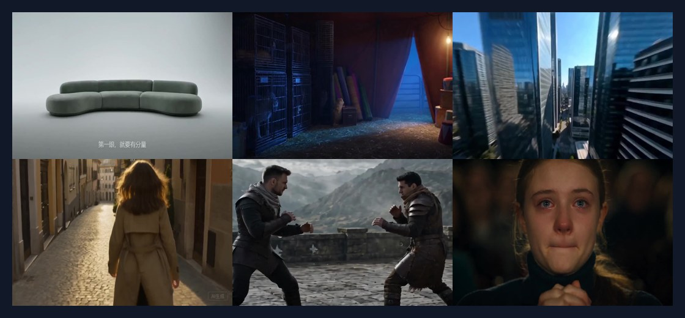
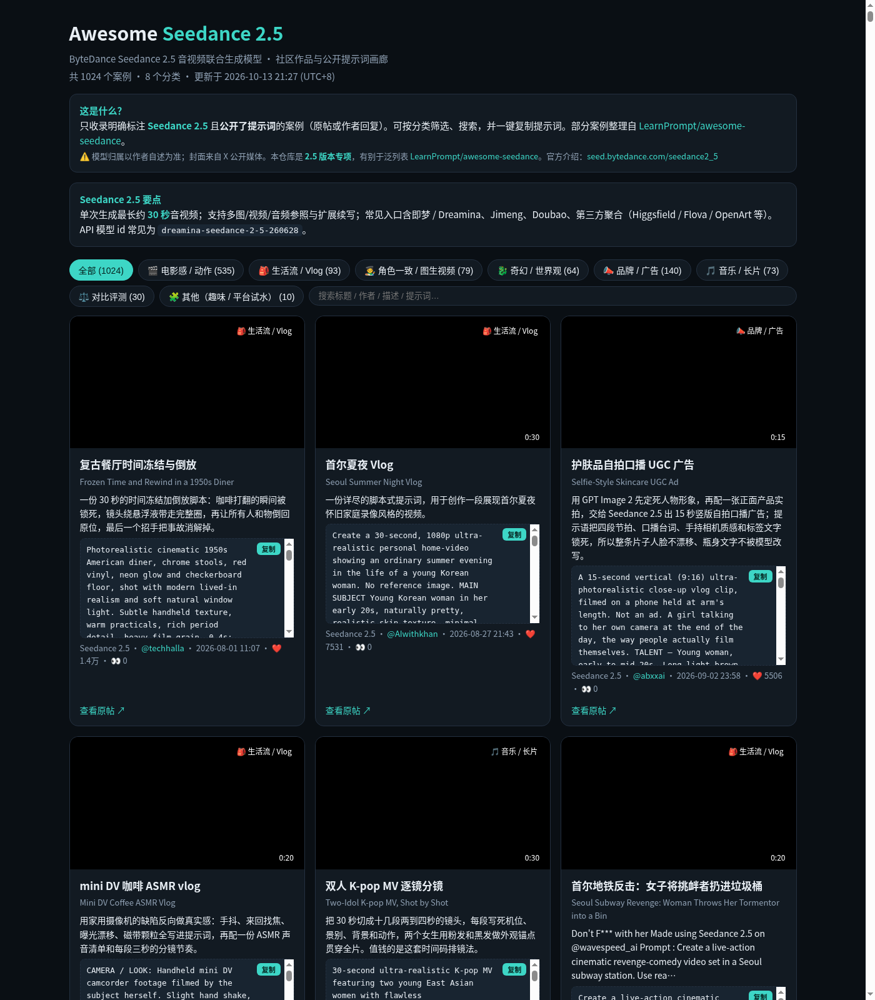
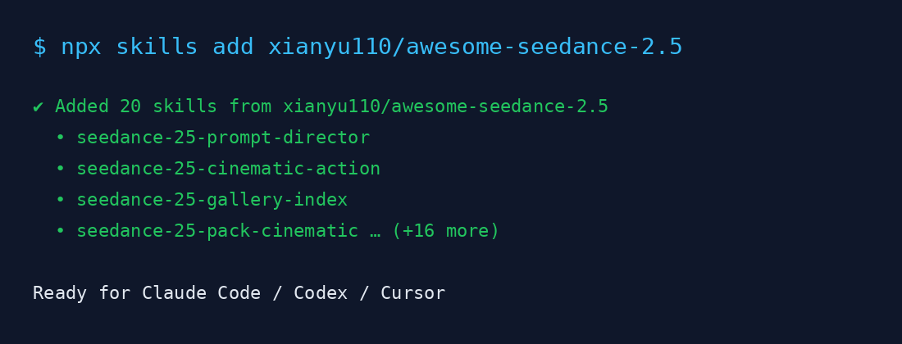

> 在线阅读（GitHub Pages）：https://maynor996.github.io/awesome-seedance-2-5/

# Awesome Seedance 2.5：1024 条公开提示词画廊 + 20 个可安装 Agent Skills 使用指南

## 写在前面

ByteDance Seedance 2.5 把音视频联合生成又往前推了一步：单次大约 4–30 秒、支持多图/视频/音频参照和续写，常见入口包括即梦 / Dreamina、Jimeng、Doubao，以及 Higgsfield、Flova、OpenArt 等。模型能力在涨，可复用的「公开提示词」却仍然散落在 X 帖子和各个 awesome 仓库里。

我维护的仓库 **awesome-seedance-2.5** 就是针对这个问题做的 2.5 版本专项：只收录创作者明确标注 Seedance 2.5、并且公开了提示词的案例，目前一共 **1024** 条「封面 + 可复制提示词」，并附带 **20** 个可安装的 Agent Skills，方便在 Claude Code / Codex / Cursor 里直接调用。

- 仓库：https://github.com/xianyu110/awesome-seedance-2.5
- 在线画廊：https://xianyu110.github.io/awesome-seedance-2.5/



*图注：仓库内公开案例封面拼贴（本地 assets/covers 抽样）。完整可筛可选画廊见上方链接。*

> 说明：跨版本、更大范围的合集可看 LearnPrompt/awesome-seedance；本仓库刻意做成「2.5 only + 必须有 prompt」，避免和泛列表重复。

## 仓库里有什么

### 1. 1024 个 prompt + cover 案例

每条案例尽量做到：预览封面、作品链接、创作者署名、可一键复制的提示词。数据按 URL / 提示词哈希去重，导入条目在 `cases.json` 里保留 `source_attribution`。

当前大致分类体量（会随更新浮动）：

| 分类 | 数量级 | 适合做什么 |
|------|--------|------------|
| 电影感 / 动作 | ~535 | 预告片节拍、追逐、打斗、一镜到底 |
| 品牌 / 广告 | ~140 | UGC 口播、产品片、品牌叙事 |
| 生活流 / Vlog | ~93 | DV 手持、日系生活、旅行片段 |
| 角色一致 / 图生视频 | ~79 | 角色卡锁定、I2V 工作流 |
| 音乐 / 长片 | ~73 | MV 分镜、多段拼接 |
| 奇幻 / 世界观 | ~64 | 龙骑士、魔法对决、POV 探索 |
| 对比评测 | ~30 | 多模型对照素材 |
| 其他 | ~10 | 尚未归类的边角案例 |

收录标准很硬：作者/条目写明 Seedance 2.5；提示词长度 ≥80 字；有封面；优先原帖或带署名的公开仓库，不收纯转发。

### 2. GitHub Pages 画廊

打开 https://xianyu110.github.io/awesome-seedance-2.5/ 即可：

- 按分类筛选
- 关键词搜索
- 一键复制提示词
- 跳回原帖核对上下文



*图注：GitHub Pages 画廊首页（分类 Tab + 卡片网格，截图时间 2026-10-13 UTC+8）。*


*图注：单条案例封面示例（可在画廊内点开复制完整提示词）。*

### 3. 20 个 Agent Skills

Skills 分成两类：

1. **导演 / 主题技能（12）**  
   例如 `seedance-25-prompt-director`（分镜时间线、角色卡、DV 语法、音频层、防废话规则）、`seedance-25-cinematic-action`、`seedance-25-dv-day-in-life`、拳击手持、机甲背包变形、猫骑士对决、角色锁定 I2V、格斗 previz 管线、品牌片、长 MV、画廊索引等。

2. **分类提示词包（8）**  
   `seedance-25-pack-cinematic` / `lifestyle` / `character` / `fantasy` / `commercial` / `music` / `compare` / `other`。每个包内有 `SKILL.md`、`prompts/` 精选公开提示词和 `PROMPTS.md`，适合直接拷进 Dreamina。

## 怎么用 Skills

环境需要本机已装 Node（用于 `npx`），以及你正在用的 Agent 客户端（Claude Code / Codex / Cursor 其一即可）。

```bash
npx skills add xianyu110/awesome-seedance-2.5
```



*图注：`npx skills add xianyu110/awesome-seedance-2.5` 安装示意（装完可在 Claude Code / Codex / Cursor 中调用）。*

装好后可以这样玩：

1. 先让 Agent 加载 `seedance-25-prompt-director`，用导演口吻写出 4–30 秒分镜（镜头、运镜、台词/环境音、画幅与时长）。
2. 若已有明确题材，再挂对应主题技能（如拳击、机甲、品牌片）。
3. 需要「可直接粘贴的成品 prompt」时，打开对应 `seedance-25-pack-*`，从 `prompts/` 里挑一条改角色与场景。
4. 不确定有哪些公开案例时，用 `seedance-25-gallery-index` 或直接去 Pages 画廊搜。

## 快速上手路径（推荐）

1. 浏览器打开画廊，选一个分类，复制提示词，在即梦 / Dreamina 里先出一条对照片。  
2. 再 `npx skills add`，用导演技能按自己的角色卡重写一版。  
3. 觉得某条案例特别好，回仓库提 Issue，附原帖链接，方便继续扩库。

## 和「泛列表」有什么不同

网上已经有不少 Seedance 相关 awesome，容易让人困惑。简单对照：

- **LearnPrompt/awesome-seedance**：跨版本、覆盖面更大，适合做全景索引。
- **本仓库 awesome-seedance-2.5**：只做 2.5；没有公开提示词的视频一律不进；Pages 画廊和 Skills 是一等公民，而不只是 README 列表。

数据来源包括 AtlasCloudAI、BeatAPI、LearnPrompt、incendies、EvoLinkAI 等公开仓库与原帖，导入时保留署名。模型归属以作者自述为准；封面多为公开媒体或仓库内预览图。

## 写提示词时我个人会盯的几点

结合画廊里高频出现的写法，实践中比较管用的有：

- **时间线**：按秒或按镜头写（0–3s / 3–8s…），比「一段空泛形容词」稳。
- **角色卡**：外观、服装、年龄段写死，I2V 时先锁静帧再驱动动作。
- **镜头语法**：手持抖动、跟焦、推拉、画幅（9:16 / 16:9）和时长写进 prompt。
- **音频层**：环境声、台词、BGM 分开描述，避免模型只顾画面。
- **反废话**：少堆「杰作、8K、超真实」这类空词，多写可执行的动作与物理反馈。

这些规则也写进了 `seedance-25-prompt-director`，装上 Skills 后可以直接让 Agent 按同一套规范改稿。

## 链接汇总

| 用途 | URL |
|------|-----|
| GitHub 仓库 | https://github.com/xianyu110/awesome-seedance-2.5 |
| 在线画廊 | https://xianyu110.github.io/awesome-seedance-2.5/ |
| Skills 安装 | `npx skills add xianyu110/awesome-seedance-2.5` |
| 官方模型介绍 | https://seed.bytedance.com/en/seedance2_5 |
| 跨版本合集（对照） | https://github.com/LearnPrompt/awesome-seedance |

如果这篇文章对你有帮助，欢迎 Star 仓库，也欢迎把你的公开提示词案例丢到 Issue。后续会继续补封面质量、分类精度和 Skills 说明。

—— xianyu110 / 博客：blog.csdn.net/xianyu120